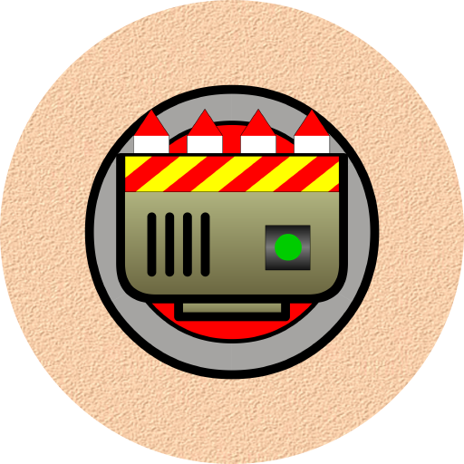
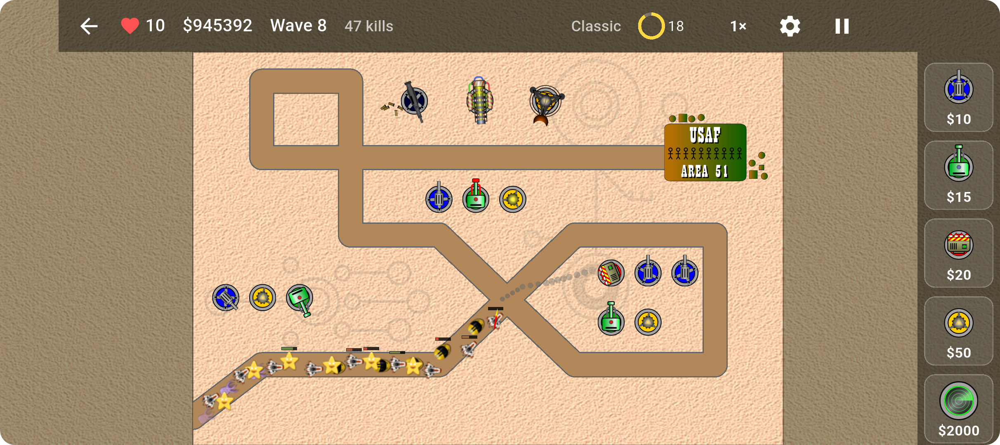
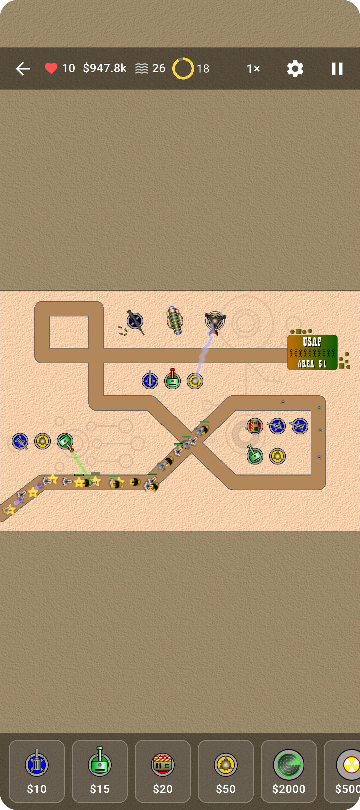
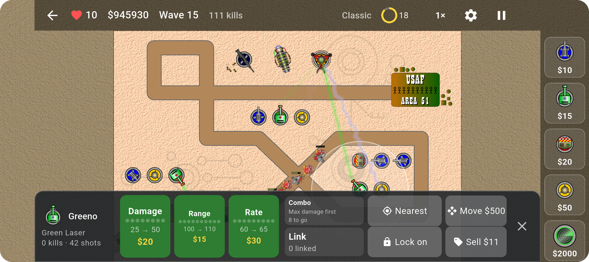
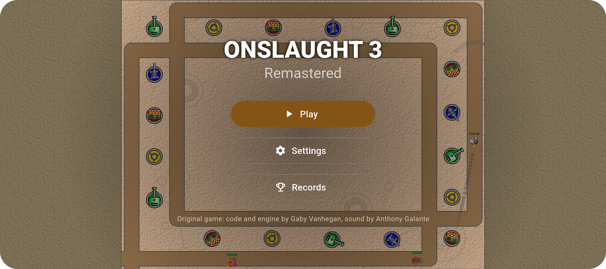
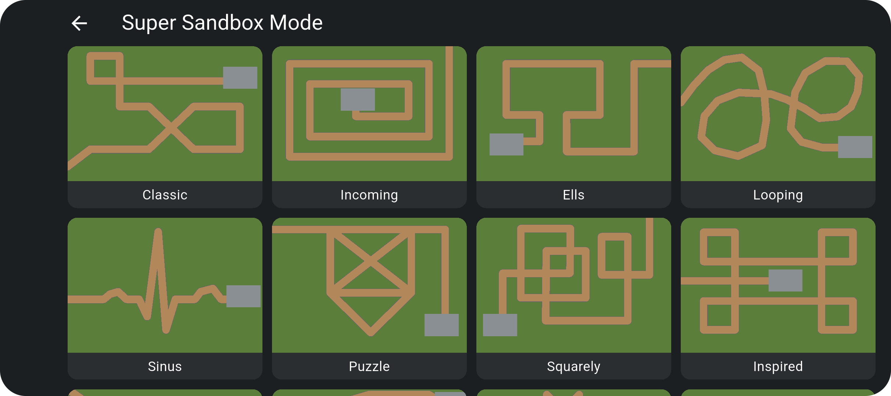

<p align="center">
  
</p>

<h1 align="center">Onslaught 3 Remastered</h1>

<p align="center">
  <strong>Build turrets. Max them out. Park the right ones side by side and watch them fire a nuke.</strong><br>
  A much-loved Flash tower-defence game, rebuilt for phones, tablets, desktop and the web.
</p>

<p align="center">
  <a href="https://zlshames.github.io/onslaught3-remastered/"></a>
  <a href="https://github.com/zlshames/onslaught3-remastered/releases"></a>
  <!-- Google Play and App Store badges go here once the listings exist. -->
</p>

<p align="center">
  <a href="https://github.com/zlshames/onslaught3-remastered/actions/workflows/ci.yml"></a>
  <a href="https://github.com/zlshames/onslaught3-remastered/actions/workflows/release.yml"></a>
  <a href="LICENSE"></a>
  <a href="https://flutter.dev"></a>
</p>

<p align="center">
  
</p>

> **Public beta.** All of the original game is here and playable. Expect the odd rough edge, and
> please [tell us about them](#reporting-bugs).

## What is it?

Waves of bugs, tanks and worse are marching down a road towards your base. It says *USAF Area 51*
on the sign, so no pressure.

You stop them with turrets in four colours: **Blue** cannons, **Green** lasers, **Red** rockets and
**Yellow** tazers. So far, so tower defence. The twist is the combos: max out a turret's damage,
put the right neighbours next to it, and together they fire something much worse. A Red with two
Blues beside it launches a **nuke**. Other mixes give you **black holes**, **napalm**, **shockwaves**,
**rocket BFGs** and more, 20 weapons in all. Where you build matters as much as what you build.

## Play it your way: portrait or landscape

Hold your phone however you like. The game works **in both portrait and landscape**, on phones,
tablets and in the browser, and you can turn the device mid-wave without missing a beat. The
controls move to wherever the screen has room, and the layout follows the shape of your screen, so
a resized desktop window or a phone browser gets the same treatment.

<table>
  <tr>
    <td width="30%" align="center"></td>
    <td width="70%" align="center"></td>
  </tr>
  <tr>
    <td align="center"><sub>Portrait: a game starts with the map in view; pinch or double-tap to zoom in</sub></td>
    <td align="center"><sub>Landscape: upgrading a Green Laser</sub></td>
  </tr>
</table>

## What's in the game

- **The whole original game:** 4 colour turrets and their specials, 20 combo weapons, modifier
  auras, super turrets and 12 maps.
- **Endless waves** on four difficulties, plus challenges, a sandbox with a mountain of cash, and
  a tutorial.
- **A map editor and a mod editor**, with share codes you can paste to a friend.
- **Built for touch:** pinch, pan and double-tap, with drag-and-drop or drop-and-lock placement.
- **Pick up where you left off:** leaving a game stores it for later.
- **Accessibility:** colour-blind badges on turrets, screen reader labels and large text support.
- **English and German** (machine-translated, so corrections are welcome).
- **No ads, no accounts, no tracking.** Saves stay on your device.

<table>
  <tr>
    <td width="50%"></td>
    <td width="50%"></td>
  </tr>
</table>

## Where to play

| Platform | Where to get it | Runs on |
| --- | --- | --- |
| **Web** | [Play in your browser](https://zlshames.github.io/onslaught3-remastered/) | Any modern browser, portrait or landscape |
| **Android** | [Download the APK](https://github.com/zlshames/onslaught3-remastered/releases) | Android 7+ (ARM and x86) |
| **Google Play** | Not yet, but maybe one day | |
| **Windows** | [Download the zip](https://github.com/zlshames/onslaught3-remastered/releases) | Windows 10 or 11 (x64 and ARM64) |
| **macOS** | [Download the zip](https://github.com/zlshames/onslaught3-remastered/releases) | macOS 12+ (Intel and Apple silicon) |
| **Linux** | [Download the tar.gz](https://github.com/zlshames/onslaught3-remastered/releases) | Ubuntu 22.04 or newer, or similar (x64 and ARM64) |
| **iOS / App Store** | Not yet, but maybe one day: iPhones and iPads can [play in the browser](https://zlshames.github.io/onslaught3-remastered/) | |

Saves stay on the device, or in the browser's storage for the web build, so uninstalling the app or
clearing site data removes them.

<details>
<summary><strong>Which file do I download, and how do I install it?</strong></summary>

**Android.** Pick the file for your phone and allow your browser or file manager to install apps
when Android asks:

- `…-android-arm64-v8a.apk`: most phones
- `…-android-armeabi-v7a.apk`: older phones
- `…-android-x86_64.apk`: emulators and some Chromebooks
- `…-android-universal.apk`: if you are not sure (it is about twice the size)

**Windows.** Take `…-windows-x64.zip`, or `…-windows-arm64.zip` on an ARM PC. Extract the whole
folder and run `onslaught3_remastered.exe`. The beta is not code-signed yet, so on the SmartScreen
warning choose More info → Run anyway. If a DLL is reported missing, install the
[Visual C++ Redistributable](https://learn.microsoft.com/cpp/windows/latest-supported-vc-redist).

**macOS.** `…-macos-universal.zip` runs on Intel and Apple silicon. The beta is not notarized yet,
so unzip it, try to open the app, then choose System Settings → Privacy & Security → Open Anyway.

**Linux.** Take `…-linux-x64.tar.gz` or `…-linux-arm64.tar.gz`, extract it and run
`onslaught3_remastered`. It needs glibc 2.35 or newer, GTK 3 and GStreamer:

```bash
sudo apt install libgtk-3-0 gstreamer1.0-plugins-base gstreamer1.0-plugins-good
```

**Host it yourself.** Serve the folder in `…-web.zip` from any path over HTTP.

`SHA256SUMS.txt` on each release lists the files' checksums.

</details>

## Not in the beta yet

- **Enhanced mode**, the planned second way to play: new creeps, turrets, upgrade paths and more.
  [Read the plan](docs/ENHANCED_PLAN.md).
- **Replays:** the Watch Replay button is there, but disabled for now.
- **Known issue:** if the device cannot store a map or mod (a full disk, for example), the editor
  still says it was saved.

## Reporting bugs

Open an [issue](https://github.com/zlshames/onslaught3-remastered/issues/new/choose) with your
platform and the version. A log helps most: Settings → Diagnostics exports one as a zip to attach.
The game keeps it on your device, masks personal details such as e-mail addresses, and sends nothing
anywhere unless you share it ([details](docs/LOGGING.md)).

## Why this exists

*Onslaught* and *Onslaught 2* were written by **Gaby Vanhegan**, a University of Leeds
graduate and systems administrator who made this amazing game in his spare time.
The sound is by **Anthony Galante**.

Gaby died in 2011, and Flash followed in 2020. The game survives as a frozen Windows export and,
in the browser, through Ruffle's emulation, thanks largely to **Slipcor**, who carried it on after
Gaby. Neither was made for the mobile devices that most people now play on, so this project
rebuilds *Onslaught 2.2* from its decompiled source on a modern, cross-platform engine.

It is called *Onslaught 3 Remastered* because it is the third version and a remaster, and it has
diverged a long way from the old SWF. Slipcor's Onslaught 2.x line remains the one built on Gaby's
engine; this is a rebuild that can carry the game's memory on.

- **Classic** plays exactly as the original did: same rules, numbers, maps and combos.
  The few deliberate differences are listed in [docs/DEVIATIONS.md](docs/DEVIATIONS.md).
  The deviations are mainly to resolve some bugs and cosmetic issues to improve overall UX.
- **Enhanced** (planned, not in the beta) is where new ideas go: a better UI, new creeps and
  turrets, and new upgrade paths, without touching Classic.
  The general mechanics will stay the same, but modern tower-defense features will be added
  along with additional turrets, creeps, maps, audio and more.

<details>
<summary><strong>The full history</strong></summary>

| When | What happened |
| --- | --- |
| By March 2007 | Gaby releases *Onslaught* on his games site, playr.co.uk. |
| Mid 2007 | *Onslaught 2* is live at onslaught.playr.co.uk by June and on Kongregate from 1 July, and spreads across the Flash portals (Newgrounds, GameGum, and others). Players share maps through Gaby's site. |
| Before 2011 | **Slipcor** (Chris) asks Gaby directly whether he may carry the game on. Gaby says yes, and provided Slipcor with the original source files. |
| May 2011 | Gaby passes. His family ask for donations to **Cancer Research UK** in his memory. |
| 2017 | Slipcor learns of Gaby's death. With Flash heading for retirement, he starts porting the game so it is not lost. |
| Nov 2020 | Slipcor publishes **Onslaught 2.2** for Windows on itch.io, exported from Gaby's original files. Half of the proceeds were pledged to charity. |
| Dec 2020 | Adobe ends Flash Player. The browser versions of the game stop working. |
| 2020s | **Ruffle**, an open-source Flash Player emulator is released. Newgrounds and the Internet Archive adopt it, and portals such as Izzygames use it to keep the original *Onslaught 2(.2)* SWF playable in the browser. |
| 2026 | **Onslaught 3 Remastered** (this repo) remasters the original game, using a cross-platform language and modern game standards. Slipcor gave his explicit permission for me to maintain it and release it publicly. |

</details>

## Supporting cancer research

When Gaby passed, his family asked for donations to Cancer Research UK, and Slipcor later promised
that money made from the game would help that cause. When he gave permission to release this
remaster, the one thing he asked in return was that part of any proceeds (donations, one-time
purchases or anything else) goes to cancer research or a similar charity.

The remaster does not take any money yet. When it does, part of what it brings in will go
to cancer research.

In the meantime, if you enjoy the game, the best way to say thanks is to give directly to
[Cancer Research UK](https://www.cancerresearchuk.org/get-involved/donate), or to a cancer
research charity near you.

## Credits

- **Gaby Vanhegan** — *Onslaught* and *Onslaught 2*: code and engine.
- **Anthony Galante** — sound.
- **Slipcor** (Chris) — kept the game alive after Gaby's death: preserved Gaby's original
  files, released [Onslaught 2.2 for Windows](https://slipcor.itch.io/onslaught-2) after
  Flash was retired, and gave this remaster his blessing.

## License

The project's own source code is under the [Apache License 2.0](LICENSE). That does **not** cover the
original game's art, sound, game data and text, or anything derived from them: those belong to their
creators and are used with Slipcor's permission. [NOTICE](NOTICE) lists exactly what is excluded.

## Development

Built with [Flutter](https://flutter.dev) and [Flame](https://flame-engine.org), on a pure-Dart
simulation core with its balance numbers in data files. AI agents: start at [AGENTS.md](AGENTS.md)
(context in [.agents/](.agents/)).

- [docs/README.md](docs/README.md) — index of every document and whether it is current.
- [docs/RELEASING.md](docs/RELEASING.md) — how a release is cut and what each download is.
- [docs/REMASTER_PLAN.md](docs/REMASTER_PLAN.md) — architecture, engine choice, mobile UI
  redesign, data model, asset pipeline and phased build order.
- [docs/ONSLAUGHT2_GAME_REFERENCE.md](docs/ONSLAUGHT2_GAME_REFERENCE.md) — the original game's
  rules and balance tables, extracted from the decompiled source.
- [docs/legacy/](docs/legacy/README.md) — the original's values as a reference table, from which
  `assets/data` is generated.
- `.legacy/` — the original SWF and its FFDec exports, kept on the maintainer's machine for
  reference. It is not in the repository, and building, testing and regenerating `assets/data`
  do not need it.

Toolchain: Flutter stable via [fvm](https://fvm.app) (the version is pinned in `.fvmrc`).

```bash
fvm flutter pub get
fvm flutter run
fvm flutter analyze && fvm flutter test
(cd packages/onslaught_core && fvm dart test)
```
